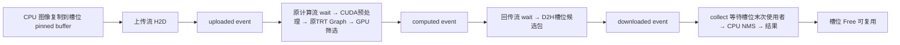

# 有界多帧异步检测接口

本实现为 YOLO11、固定 `[1,3,640,640]` 输入增加 `AsyncYOLODetector`。首轮异步后处理限定为 `gpu-filter + CPU NMS`；原 `YOLODetector::detect()` 和 cpu/gpu-filter/gpu-nms 三种同步路径继续保留。启用异步期间禁止在同一个对象上调用同步 detect 或修改配置；`stopAsync()` 排空并关闭后可重新使用同步入口。

## 执行与地址策略

仍只保留原来的一个 TensorRT Execution Context、一个计算流，以及初始化时捕获的推理 Graph。Graph 只包含原来的 TensorRT 推理，输入输出地址均为原来共享的 Tensor 地址。各槽位并没有自己的 TRT Graph，replay 也不会切换地址。

保证安全的顺序是：同一个计算流依次执行 frame i 的等待上传、预处理、推理、GPU 候选筛选，再执行 frame i+1。候选筛选读完共享 Engine 输出并写入 frame i 独占的候选包后，下一次推理才能覆盖共享输出；回传只读独占候选包。输入也遵循同一计算流顺序。因此 Graph 的输入输出地址稳定且没有跨帧并发访问。



事件禁用 timing。稳定执行阶段仅在 `collect()` 等待当前槽位的 `downloaded`，不会逐阶段同步，也不会以共享计算流的全局同步等待其它帧。`enableAsync()` 有初始化同步，析构有关闭同步，它们均在测量范围外。多流与依赖使重叠成为可能，实际是否发生必须查 Nsight 时间线。

## 槽位资源与生命周期

支持 1、2、3 个槽位，启用时一次分配。每个槽位独占：

| 资源 | 生命周期与作用 |
|---|---|
| 原图 pinned host / raw device buffer | 固定 `maxImageBytes` 容量；CPU staging、H2D、CUDA预处理使用 |
| GPU 筛选后处理器 | 独立 device 候选包、持久化工作区、pinned host 候选包；回传不会读共享 Engine 输出 |
| uploaded / computed / downloaded 事件 | 同槽位循环复用；最后一次 D2H 和 CPU 读取结束后才重新 record |
| frame ID、原图尺寸、gain_x/y、pad_x/y | 随槽位保存；CPU 坐标还原不使用基类共享的 cachedScale/cachedPad |
| 时间戳、状态 | `Free → Submitting → Queued → Collecting → Free` |

`submit()` 期间调用者保证图像不被修改。它将原图复制到槽位 pinned buffer，返回后不再引用调用者的 `cv::Mat`，调用者可立即修改、释放图像。支持逐行复制非连续 CV_8UC3 ROI；空图、非二维/CV_8UC3、超过预留容量均明确报错，容量扩展必须在关闭排空后重新配置。

只有 D2H 完成、CPU NMS 和浮点坐标还原完成、候选包不再被读取时，槽位才释放。结果包返回拥有自身存储的 detections，不暴露槽位指针。稳定阶段没有新增 cudaMalloc、cudaMallocHost、CUDA Event 创建；CPU 的候选/结果 vector 分配仍存在。

## 调用约定

接口为单提交者、单收集者（SPSC），两者可以在不同 CPU 线程并发执行。配置、restart、stop、析构要求调用者管理好线程生命周期，不能与运行中的接口并发。CUDA 调用线程会设置初始化时记录的设备。

```cpp
#include "yolos/tasks/async_detection.hpp"

yolos::det::AsyncYOLODetector detector(engine, labels, yolos::YOLOVersion::V11);
detector.setPostprocessMode("gpu-filter");
detector.setMaxDet(300);
detector.setGraphEnabled(true);
detector.enableAsync(2, maxImageBytes, 0.25f, 0.45f);

// Producer: each successful submit accepts exactly one frame.
// On exceptions, retain the exception and close submissions so collect can exit.
std::thread producer([&] {
    try {
        for (uint64_t id=0; id<images.size(); ++id) detector.submit(images[id], id);
    } catch (...) { producerFailure=std::current_exception(); }
    detector.closeSubmissions();
});
try {
    while (auto result=detector.collect()) consume(result->frameId, result->detections);
} catch (...) {
    detector.closeSubmissions();
    producer.join();
    throw;
}
producer.join();
if (producerFailure) std::rethrow_exception(producerFailure);
auto remaining=detector.stopAsync(); // empty after complete collection
```

完整可编译示例是 `src/async_pipeline_benchmark.cpp` 中的 `batch()`。

frame ID 在一个 batch 内必须严格递增，重复、回退均报错。FIFO collect 返回提交顺序。下一槽位不可用时 submit 阻塞，既不覆盖旧帧也不静默丢帧。提交和收集必须并发，或由调用者保证在提交超过容量前收集；单线程连续 submit 超过容量会按背压契约等待。

`closeSubmissions()` 允许已经占用槽位、正在提交的帧提交完成，并阻止尚未获得槽位的提交；`collect()` 在关闭且所有已接收帧收集完成后返回 nullopt。`drain()` 关闭并返回所有剩余结果；`stopAsync()` 在提交/收集线程结束后排空并释放槽位。析构仅等待设备使用完成并释放资源，无法向已经消失的调用者返回结果；遗漏显式排空时会警告。

`restartAsyncBatch()` 仅允许已关闭、排空、调用线程已退出时执行，用于热身后开启正式测量。它重置 ID、FIFO 和计数，保留所有地址、容量和 CUDA 资源。

## 测量边界

预读所有图像，模型初始化、资源分配和热身在测量外。稳定阶段无 profiler 的正式测量与 Nsight 时间线分开执行。

- 同步延迟：内存图像进入 detect，到 CPU 检测结果可用。
- 异步逐帧延迟：进入 submit（包括槽位背压等待），到 collect 中 CPU 最终检测结果可用；计算队列、FIFO 等待全部包含。
- admitted latency：成功预留槽位之后到 CPU 最终结果可用，仅用于分辨背压；GPU/FIFO 等待仍包含，不是纯 GPU 服务时间。
- submit wait：submit 进入到预留槽位，包括取得锁和等容量的时间。
- collection queue：完成 host enqueue 到 collect 取出 FIFO 帧；不是纯 GPU 队列时间。collect event wait 和 CPU 后处理另外记录。
- 持续吞吐：整个 batch 的完成帧数 / 完全排空并 join 提交线程后的 wall time，包括线程创建和批次尾部排空。既不是提交速度，也不是 `1000/平均逐帧延迟`。

CSV 每帧保留小数毫秒；JSON 汇总平均、P50、P95。异步逐帧 CPU 各时间区间存在重叠，不应机械相加来还原 batch 耗时。结果保存、读盘、绘制、显示、视频编解码均不包含。

## 复现

```bash
conda activate yolos-trt
cmake --build build -j4

# 原 dbf85ba 同步二进制已冻结；拒绝 Engine/hash 变化或覆盖旧输出
python scripts/async_pipeline/reproduce_sync.py \
  --output-prefix results/async_pipeline/reproduce_new/sync --checks

# 完整对照；选择空目录。WSL workaround 临时改 Nsight 配置，finally 恢复。
python scripts/async_pipeline/run.py \
  --output results/async_pipeline/rerun --frames 2800 --warmup 30 --rounds 2 \
  --nsight --wsl-cupti-workaround

# 单独入口：0为同步，1/2/3为槽位数；--validate 包含完整生命周期检查
./build/async_pipeline_benchmark models/yolo11n.trt models/coco.names \
  results/baseline/samples results/async_pipeline/manual/s2 \
  --slots 2 --frames 2800 --warmup 30 --graph 1 --validate

# 有真实COCO标签时执行；没有数据时写blocked状态，不制造mAP
python scripts/async_pipeline/dataset_accuracy.py \
  --annotations /path/to/instances_val2017.json --images /path/to/val2017 \
  --output results/async_pipeline/coco_validation
```

数据集评估沿用 conf=.25、IoU=.45、max_det=300；COCOeval 使用标准 maxDets=[1,10,100]。该阈值下的 AP 不应冒充低置信度完整召回设置的模型官方 mAP。安装 `scripts/async_pipeline/requirements-accuracy.txt` 并用 `prepare_coco.py` 准备完整 val2017 后，`dataset_accuracy.py` 对照 CPU、同步 gpu-filter、异步2槽，检查全部 frame ID 和原图尺寸，再评估真实 AP。当前已实际完成5000图验证，结果见根目录 `部署基线交付与COCO精度验证.md`；原先缺少数据的状态文件保留为历史记录。

本地正式结果、版本、复现命令、每帧原始数据、地址 CSV 与独立时间线位于 `results/async_pipeline/final`；汇总见项目根目录 `多帧异步流水线实现与实测.md`。
