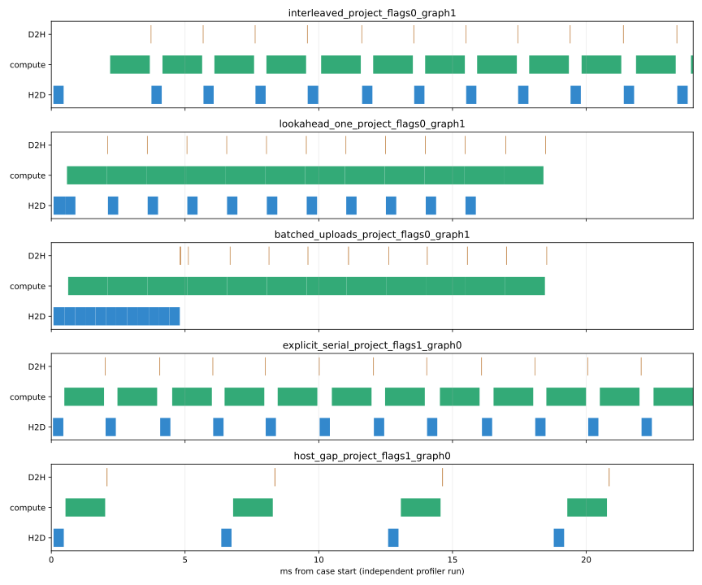

# 拷贝与 kernel 未重叠：主机提交间隙与设备调度的区分

本轮只做诊断，未修改检测运行时、缓冲区、TensorRT Engine 或原 Graph 捕获范围。基线 commit：`f5618244c2f583485b9f2ec36c858f0a80a25dec`。诊断代码及真实结果新增在工作区，尚未提交；原同步/2槽性能与完整 COCO 数据保持不变。

## 结论

现有2槽路径的零拷贝/计算重叠，主要证据指向 **逐帧交错提交的顺序与当前拷贝调度耦合**：H2D(0) → compute(0) → 等待compute(0)的D2H(0) → H2D(1)。虽然后一个上传流没有显式等待前一个回传流，已提交、尚未满足依赖的D2H(0)仍可能在共享拷贝队列中挡住H2D(1)。这是与队列头阻塞一致的解释；没有直接观测驱动内部队列，不能将它提升为已证明的具体驱动内部实现。

只把H2D(1)放到D2H(0)之前提交，最小CUDA对照便出现明显拷贝/kernel重叠。相同机器、驱动、CUDA、pinned内存、三个流、每帧事件和kernel保持一致；普通命名流/non-blocking流、Graph开关均复现。因此当前GPU/WSL环境具备实际重叠能力，Graph并没有普遍禁止重叠。

同步与2槽之间原来的24.15%吞吐收益，实测证据支持主要通过减少主机准备/提交造成的跨帧空隙实现；无法把该比例精确分摊到各阶段。不能用本轮微基准的重叠比例代替YOLO端到端提升。生产检测调度尚未修改。

## 环境、能力与版本

- RTX 4060 Laptop GPU，驱动591.86；WSL2，内核6.18.33.2-microsoft-standard-WSL2。
- CUDA Toolkit/runtime 12.4，deviceQuery所见CUDA driver API版本13.1；不是把nvidia-smi所示CUDA上限当成Toolkit版本。
- deviceQuery实际返回 Concurrent copy and kernel execution: Yes，1 copy engine；这是**当前CUDA环境暴露的能力**，不据此推广所有RTX 4060或推断虚拟化之下的物理引擎数量。单拷贝引擎也可以与独立计算引擎并发，但不能期待H2D和D2H同时执行。
- TensorRT C++10.7，Nsight Systems2025.3.2；原YOLO11n 640×640、batch=1、FP16构建/FP32 I/O Engine不变。
- Engine SHA256：`de97ab4e249a501cd138e0cc2ce66d38c5b69615933bf11d30d2bfddae8b1270`。基准二进制SHA256仍为`793f8d79d122ce60fe022219fea52517c8244821709b67e4f42281ea50e5bb2c`。源与二进制hash见`sha256.json`。

## 四类原因分别看什么证据

| 原因 | 当前证据 | 可下的结论 |
|---|---|---|
| 主机供给间隙 | 旧同步trace提前提交0/139；旧2槽139/139，D2H→下一个H2D空隙从0.2823ms降为0.0016ms | 解释2槽更连续、原24.15%吞吐收益；不能解释已经提前入队仍串行的全部现象 |
| 程序依赖/提交顺序 | 没有upload(i+1)等待download(i)的事件；但API按先D2H(i)、后H2D(i+1)发出；顺序对照解除串行 | 顺序是本环境中可验证的触发因素，调度/队列头阻塞解释得到支持 |
| 硬件/当前暴露能力 | 设备报告支持copy+compute、一个copy engine；同机同驱动控制实验实际重叠 | 排除完全没有copy+compute并发能力；单引擎共享约束与现象一致 |
| 驱动/WSL调度 | 交错提交串行、前瞻上传重叠；但没有同GPU原生Linux/Windows或其它驱动对照 | 不能认定驱动bug，不能精确拆出物理FIFO、驱动批处理、WDDM/WSL调度各自责任 |

主机cudaMemcpyAsync返回，表示API调用已返回；**不等同于命令已进入物理copy engine或马上执行**。对照可区分“应用尚未提交”与“提交后受依赖/调度影响”，不能直接看见驱动内部投递时刻。

## 实际检测时间线：Graph开关独立复测

使用原benchmark二进制和同一Engine，2槽、预读原7图、140帧、每图热身5次、--timeline。以下是profiler运行，只用于诊断；不替换无profiler正式性能。

| Graph | 下帧H2D API已在前帧D2H GPU结束前返回 | 下帧H2D仍在前帧D2H GPU结束之后开始 | H2D/kernel交集ms | D2H/kernel交集ms |
|---|---:|---:|---:|---:|
| 0 | 124/139 | 139/139 | 0.0000 | 0.0000 |
| 1 | 139/139 | 139/139 | 0.0000 | 0.0000 |

Graph关闭增加逐kernel主机提交，因而部分下帧API未能提前返回；Graph开启139/139提前提交却仍全部串行。Graph关闭也没有出现copy/kernel交集，因此不能把未重叠仅归因于Graph。

两个trace的实际GPU活动均为：计算stream13、上传stream18、回传stream19。稳定区间每帧有等待完成的cudaEventSynchronize，但没有cudaDeviceSynchronize、cudaStreamSynchronize或逐帧显存/pinned分配。内核/拷贝/memset活动未落在NULL stream。

实际源码`include/yolos/core/trt_utils.hpp`使用cudaStreamCreate，三个生产流均为普通**命名blocking流**，不是cudaStreamNonBlocking。Nsight枚举flag=1为普通流，flag=3才是NULL stream；不要把元数据中的“Default stream”文字误读成生产任务在NULL stream执行。NULL stream存在于进程初始化，但测量区间没有其GPU工作。命名blocking流本身不强制彼此串行；只有涉及NULL stream的隐式依赖等因素才可能改变并发。对照中的flags=0/1是CUDA runtime的创建参数，与CUPTI枚举数值不同。

## 最小CUDA对照：已经实际执行

诊断程序`copy_overlap_probe.cu`不调用TensorRT：一个计算流、一个上传流、一个回传流，12帧各自持有独立device input/output及pinned输出，pinned上传源只读共享。所有资源和单kernel诊断Graph在CASE计时前创建；每帧upload→compute→download的依赖由事件保持。稳定CASE内没有显存/pinned分配或设备级同步，批末只等待最后一帧download事件。上传标记8经kernel变为9，回传首/末字节检查全部通过；这不是检测精度验证。

compute是24 blocks×128 threads、clock64计时的低内存流量计算占位，约毫秒级；实际持续时间以trace为准，频率变化会影响它。没有假设它等同YOLO的180个短TRT kernel。project档上传4,922,883 bytes（现有最大原图容量），回传268,816 bytes（候选包）；large档两个方向均16MiB，用于放大可见重叠，不属于实际检测负载。

- interleaved：逐帧上传→计算→回传，完全模仿当前主机提交顺序。
- lookahead_one：上传0；逐帧计算i→提前上传i+1→回传i，只将下一帧上传放到本帧回传之前。
- batched_uploads：先所有上传，再所有计算，再所有回传，作为可并发正对照。
- explicit_serial：原交错顺序额外让upload(i)显式等待download(i-1)，作为设备依赖负对照。
- host_gap：原交错顺序，下一帧上传前CPU额外sleep 6ms，作为尚未提交的主机间隙负对照。

诊断每种顺序都预分配12组帧资源，便于一次性预提交并排除背压；**lookahead_one是提交顺序对照，不是已经实现的有界2槽检测调度**。

下表全部来自独立Nsight实际GPU区间，重叠计算为区间并集的交集。H2D占比 = 与kernel重叠的H2D时间 / H2D忙碌时间，不是占整个批次或kernel时间的比例。每项12帧，不将单次总耗时用于正式性能结论。

| 对照 | H2D∩kernel ms | H2D重叠比例 | D2H∩kernel ms | 提前提交下帧H2D |
|---|---:|---:|---:|---:|
| interleaved_project_flags0_graph0 | 0.0000 | 0.00% | 0.0000 | 11/11 |
| lookahead_one_project_flags0_graph0 | 4.1728 | 89.23% | 0.2446 | 11/11 |
| batched_uploads_project_flags0_graph0 | 3.7751 | 81.87% | 0.2611 | 11/11 |
| interleaved_project_flags0_graph1 | 0.0000 | 0.00% | 0.0000 | 11/11 |
| lookahead_one_project_flags0_graph1 | 4.1879 | 89.33% | 0.2438 | 11/11 |
| batched_uploads_project_flags0_graph1 | 4.1537 | 88.15% | 0.2512 | 11/11 |
| interleaved_large_flags0_graph0 | 0.0000 | 0.00% | 0.0000 | 11/11 |
| lookahead_one_large_flags0_graph0 | 2.4123 | 15.33% | 14.8941 | 11/11 |
| batched_uploads_large_flags0_graph0 | 14.4135 | 90.77% | 3.3843 | 11/11 |
| interleaved_large_flags0_graph1 | 0.0000 | 0.00% | 0.0000 | 11/11 |
| lookahead_one_large_flags0_graph1 | 2.3845 | 15.02% | 14.9686 | 11/11 |
| batched_uploads_large_flags0_graph1 | 14.3301 | 90.71% | 3.6666 | 11/11 |
| interleaved_project_flags1_graph0 | 0.0000 | 0.00% | 0.0000 | 11/11 |
| lookahead_one_project_flags1_graph0 | 4.1522 | 90.05% | 0.2496 | 11/11 |
| batched_uploads_project_flags1_graph0 | 4.1374 | 90.00% | 0.2494 | 11/11 |
| explicit_serial_project_flags1_graph0 | 0.0000 | 0.00% | 0.0000 | 11/11 |
| host_gap_project_flags1_graph0 | 0.0000 | 0.00% | 0.0000 | 0/11 |
| interleaved_project_flags1_graph1 | 0.0000 | 0.00% | 0.0000 | 11/11 |
| lookahead_one_project_flags1_graph1 | 4.1665 | 89.64% | 0.2580 | 11/11 |
| batched_uploads_project_flags1_graph1 | 4.1829 | 90.06% | 0.2511 | 11/11 |
| interleaved_large_flags1_graph0 | 0.0000 | 0.00% | 0.0000 | 11/11 |
| lookahead_one_large_flags1_graph0 | 2.2550 | 14.30% | 15.1340 | 11/11 |
| batched_uploads_large_flags1_graph0 | 14.2967 | 90.69% | 3.5070 | 11/11 |
| interleaved_large_flags1_graph1 | 0.0000 | 0.00% | 0.0000 | 11/11 |
| lookahead_one_large_flags1_graph1 | 2.1505 | 13.55% | 15.3135 | 11/11 |
| batched_uploads_large_flags1_graph1 | 14.2259 | 90.43% | 3.8583 | 11/11 |

所有8组交错提交（两种流×两种尺寸×Graph开关）均为零重叠；提前一帧及批量上传均出现重叠。普通流+Graph开启、project档，前瞻上传的H2D/kernel交集为4.1879ms、H2D时间占比89.33%；这远大于微秒级时间戳噪声。显式串行负对照仍11/11提前入队但没有重叠，主机间隙负对照则0/11提前入队；因此“host已经提交”只是必要观察，不是GPU一定并发的保证。

所有26项H2D/D2H相互交集为0，与当前单copy engine暴露能力一致。只证明本环境的调度行为，不宣称所有CUDA设备都严格服从同样FIFO策略。



## 下一步应改哪里

优先评估**有界2槽内的提前上传调度**：在不改变原TRT Graph固定I/O和串行Context的情况下，使H2D(i+1)在等待compute(i)的D2H(i)之前提交。需要拆开当前submit里“一次提交整帧全部GPU工作”的边界，并处理最后一帧没有下一帧、队列暂空、退出排空、CPU collect先到等情况；不能只删事件或延后回传而造成单帧死锁。槽位必须保持末次设备/CPU使用后才复用。

先用真实Engine逐帧结果、frame ID、1/2/3槽与满队列/尾部排空验证，再测无profiler完成吞吐和含背压的逐帧延迟，另采时间线确认真的重叠。微基准重叠89%不代表端到端会提升89%，也不保证提前上传一定提高该Engine吞吐。当前不建议为了追求重叠直接新增Context、改GPU NMS或扩大Graph。

若还要把驱动与物理引擎责任精确分开，需在同一GPU原生Linux/Windows及不同驱动下跑相同探针；本轮未具备这些对照条件。

## 复现与原始数据

```bash
source /home/wnyxvo/miniconda3/etc/profile.d/conda.sh
conda activate yolos-trt
python scripts/async_pipeline/overlap_diagnosis.py
# 使用已有SQLite重新分析，不重新采样：
python scripts/async_pipeline/overlap_diagnosis.py --analyze-only
```

完整命令在`results/async_pipeline/overlap_diagnosis/commands.json`。脚本默认覆盖本诊断目录；保留历史数据时先复制该目录。原`final`、`attribution_delivery`、`coco_release`均不覆盖。

输出：设备与系统日志、源码/Engine/benchmark hash、无profiler和独立profiler两份26项CSV、26项区间分析JSON、两个原Engine Graph开关的140帧原始CSV和Nsight分析、每次运行/导出日志，以及本地controls/pipeline_graph0/pipeline_graph1的.nsys-rep和.sqlite。大型Nsight原始报告遵循现有.gitignore留本地，其分析、原始逐帧CSV及关键关联时间戳JSON可随源码交付。

WSL仍需CuptiUseRawGpuTimestamps=false，否则本机没有GPU活动表。脚本临时写入nsys -z返回的配置文件，并用finally按原始字节恢复或删除。NVIDIA说明此workaround的GPU/CPU时间戳转换精度较低；不使用纳秒级差值解释驱动开销，不把profile总时间当作无profiler性能。

## 来源与边界

- [NVIDIA关于提交顺序、copy engine与重叠的示例](https://developer.nvidia.com/blog/how-overlap-data-transfers-cuda-cc/)：提供机制参考，不将旧GPU队列实现直接套用于现代GPU。
- [CUDA异步执行文档](https://docs.nvidia.com/cuda/cuda-programming-guide/02-basics/asynchronous-execution.html)：stream依赖、pinned transfer和NULL stream规则。
- [NVIDIA关于WSL Nsight时间戳的说明](https://forums.developer.nvidia.com/t/nsys-doesnt-show-cuda-kernel-and-memory-data/315536)：workaround与时间戳精度限制。

**已实际验证：** 设备能力查询；26项CUDA对照、标记数据校验和GPU活动交集；真实Engine Graph开/关各140帧的提交关联/零拷贝计算重叠；原基准二进制与Engine未变。

**静态检查及证据支持的解释：** 生产流是普通命名流；事件不存在跨帧upload等待download；交错提交与共享拷贝调度发生队列头阻塞式耦合。驱动内部队列未被直接观测。

**尚未验证：** 前瞻提交改造后的真实2槽检测正确性/吞吐/延迟；同GPU其它OS/驱动下的行为；物理引擎拓扑与WSL暴露能力之间的差别。本轮没有新增生产优化、没有新增mAP或宣称新的检测加速倍数。
